<p align="center">
  
</p>

<h1 align="center">DermaTrace</h1>

<p align="center">
  Track a skin lesion over time. Photograph it, get an on-device AI check, and compare it with earlier scans.
</p>

<p align="center">
  <a href="#overview">Overview</a> ·
  <a href="#features">Features</a> ·
  <a href="#how-it-works">How it works</a> ·
  <a href="#under-the-hood">Under the hood</a> ·
  <a href="#getting-started">Getting started</a> ·
  <a href="#testing">Testing</a> ·
  <a href="#limitations-and-next-steps">Limitations</a> ·
  <a href="#screenshots">Screenshots</a>
</p>

---

## Overview

Most people who watch a mole or a skin spot keep their photos in the phone gallery, with no dates, no body location and no notes. A doctor mainly wants to know whether a spot has *changed*, and scattered photos make that hard to answer.

DermaTrace keeps everything about a lesion in one place. Each scan is checked for photo quality, passed through four small AI models that run on the phone, and saved next to the earlier scans of the same lesion, so two photos can be compared side by side. Reminders prompt the user to take the next photo, and any result can be exported as a PDF.

It is a college project for the Mobile Application Development course at SVKM's NMIMS (MPSTME).

> **DermaTrace is an educational prototype. It does not diagnose anything, it has not been clinically validated, and its output is not medical advice.** The result screens and reports say so every time.

## Features

**Records**
- Patient profiles, each with any number of lesions (label, body location, notes).
- Every scan is saved with its photo, date and result. Records stay on the phone, in a local SQLite database.

**Analysis**
- Take a photo with CameraX or choose one from the gallery. A small preview confirms which image was picked.
- Four models run on the device, so the photo is not uploaded anywhere for analysis.
- Poor photos (blurred, too dark, over-exposed) are rejected with a request to retake them.
- The result is shown as higher, lower or inconclusive model concern, plus the three most similar visual patterns, in plain language.

**Follow-up**
- History of all scans, with a note that can be added to each one.
- Side-by-side comparison of an earlier and a newer scan of the same lesion.
- Follow-up reminders that appear as notifications.
- A previous-photo overlay on the camera screen, to help line up repeat photos.

**Reports and sharing**
- PDF report with the patient name, the photo, the result and a safety note; long notes continue on extra pages.
- Plain TXT report. Both can be shared from the app. PDFs are named `DermaTrace_<Name>_<Date>_Report.pdf`.

**Account and extras**
- Sign-in with Firebase Authentication (email and password, or Google).
- Shortcuts to find a dermatologist in a maps app, or call or e-mail a saved clinician.
- Optional text explanation from a local Ollama server. It is off by default and only the result text is sent, never the photo.

## How it works

1. The user signs in and adds a patient profile.
2. On **New analysis** they pick the patient, describe the lesion, and take or choose a photo.
3. The photo goes through the four models in order (below).
4. If the photo is poor, nothing is saved and the user is asked to retake it. Otherwise the lesion and the result are stored.
5. The result screen shows the concern level, the similar patterns, the photo quality and an explanation. From here the user can add a note, share a PDF or set a reminder.
6. Later scans of the same lesion build up a timeline that can be compared and exported.

### The four models

| Step | Model | What it decides |
|---|---|---|
| 1 | Image quality | Is the photo good, blurred, too dark or over-exposed? |
| 2 | Lesion segmentation | Where is the lesion, and is it fully inside the frame? |
| 3 | Concern level | A score compared against a fixed limit, shown as higher, lower or inconclusive. The score is not a probability of cancer. |
| 4 | Pattern classification | The three most similar of 11 visual patterns, each with a percentage. |

The model files in `app/src/main/assets` were supplied with the project. We did not train them, and this repository does not document their training data or accuracy, so **no accuracy claim is made**.

### Screen flow

<p align="center">
  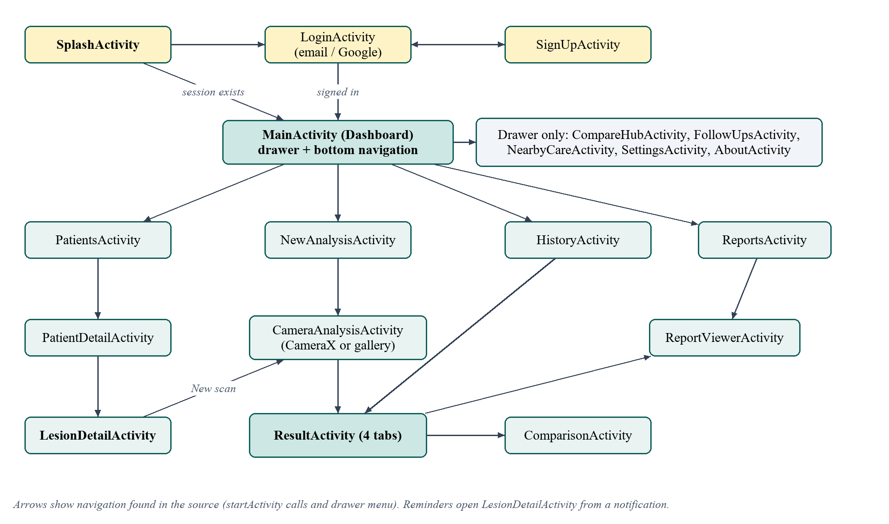
</p>

## Under the hood

| | |
|---|---|
| Language | Java, with XML layouts |
| Android | minSdk 24, targetSdk 37, single module |
| On-device AI | TensorFlow Lite through Google Play services |
| Camera | CameraX |
| Storage | SQLite (`SQLiteOpenHelper`): patients, lesions, assessments, follow-ups |
| Reminders | WorkManager and notifications |
| Sign-in | Firebase Authentication, Credential Manager |
| UI | Material Components, navigation drawer and bottom bar |
| Reports | `PdfDocument` for PDF, `FileProvider` for sharing |

### Project layout

```
app/src/main/
  java/com/dermatrace/app/
    *Activity.java     one class per screen
    adapter/           list rows for history, patients, lesions, follow-ups
    data/              SQLite helper and all queries
    ml/                loads and runs the four models
    llm/               optional Ollama client
    reminder/          follow-up scheduling and notifications
    util/              photos, reports, sharing, settings
  assets/              the four .tflite models and model_config.json
  res/                 layouts, icons, colours, menus
```

### Data model

One patient has many lesions, a lesion has many assessments (scans) and at most one follow-up reminder. Deleting a patient or lesion removes everything below it, including the stored photos.

## Getting started

1. Install Android Studio and open this folder (**File → Open**).
2. Wait for Gradle to sync. The wrapper downloads the build tools it needs.
3. Pick an emulator or a connected phone and press **Run**.

The analysis needs Google Play services on the device, so use an emulator image that includes the Play Store.

**Firebase.** `app/google-services.json` belongs to our own Firebase project. If you fork the repository, create a Firebase project, register the package name `com.dermatrace.app`, add your debug key's SHA-1 for Google sign-in, and replace that file.

**Ollama (optional).** Run Ollama on a computer, enter its address and the model name in the app's Settings, and for a USB-connected phone forward the port with `adb reverse tcp:11434 tcp:11434`.

## Testing

Tested by hand on an Android 17 emulator with synthetic images: the main flow, rejection of poor photos, permission denial, very large and damaged files, repeated taps, rotation, reminders with notifications on and off, file clean-up on delete, long notes in the PDF, offline use and large font sizes. Problems found in the first round (a crash on a 54-megapixel photo, duplicate records on a double tap, lost reminders, text running off the PDF page) were fixed and re-checked.

Not tested: sign-in, sign-up, password reset, Google sign-in and sign-out, the Ollama explanation with a live server, and use on a physical phone. The only automated test is the default example test.

## Limitations and next steps

- It does not check that a photo actually contains a lesion, so a photo of plain skin still gets a result.
- Records are not separated between signed-in accounts, and there is no cloud backup.
- Most interface text still lives in the layout files rather than `strings.xml`.

Next steps we would take: reject photos that do not show a lesion, test on real phones, keep each user's records separate, document how the models were trained and measure their accuracy, and add more automated tests.

## Screenshots

All images in the app are synthetic (AI-generated), not real patients. The camera preview shows the emulator's virtual room.

<table>
  <tr>
    <td align="center">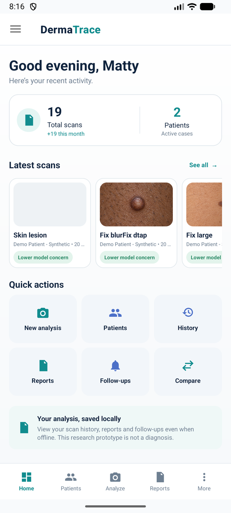<br><sub>Dashboard</sub></td>
    <td align="center">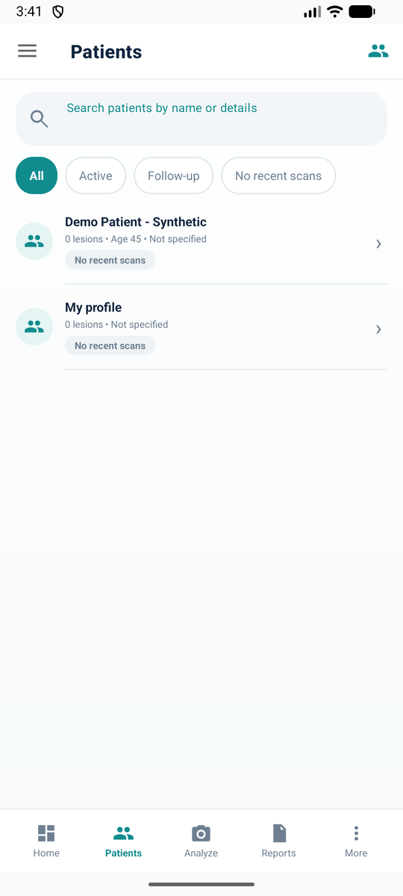<br><sub>Patients</sub></td>
    <td align="center">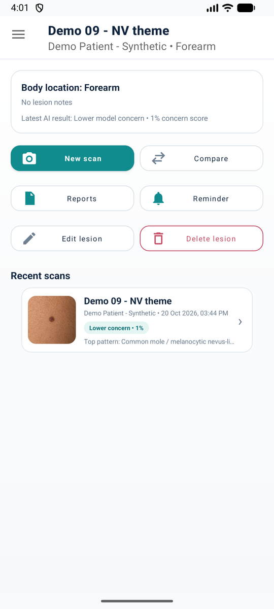<br><sub>Lesion details</sub></td>
    <td align="center">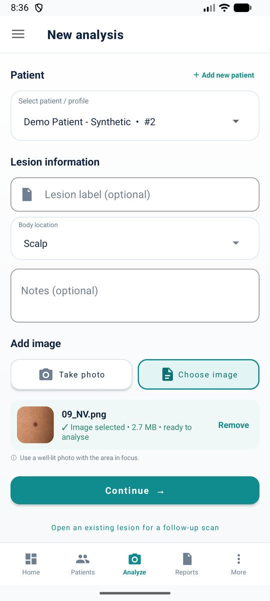<br><sub>New analysis</sub></td>
    <td align="center">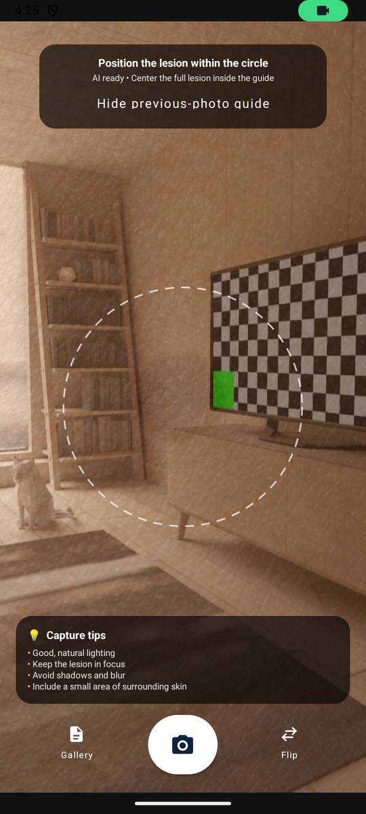<br><sub>Camera</sub></td>
  </tr>
  <tr>
    <td align="center">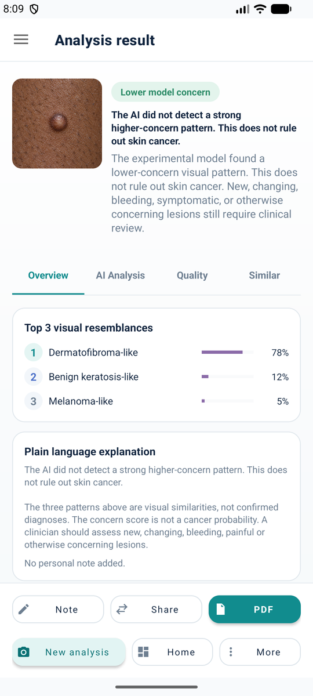<br><sub>Result</sub></td>
    <td align="center">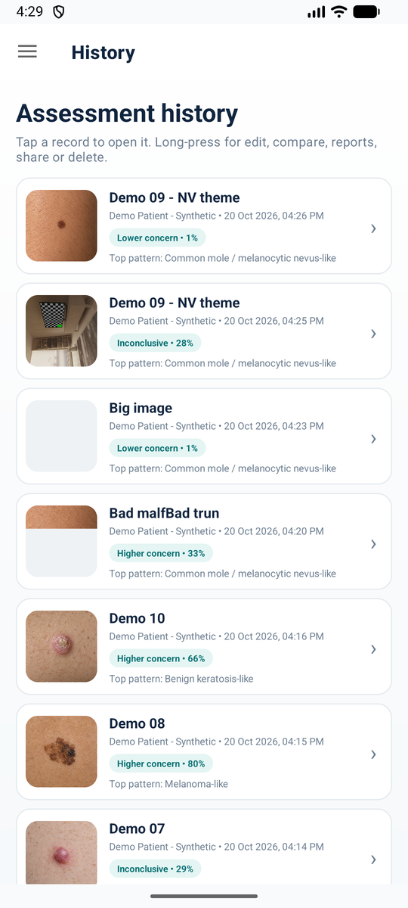<br><sub>History</sub></td>
    <td align="center">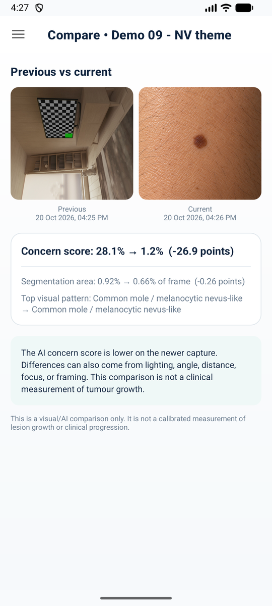<br><sub>Comparison</sub></td>
    <td align="center">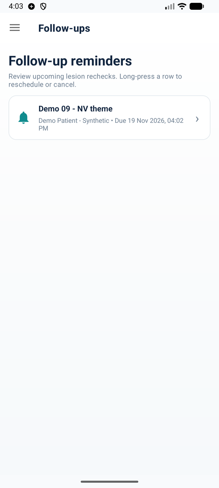<br><sub>Follow-ups</sub></td>
    <td align="center">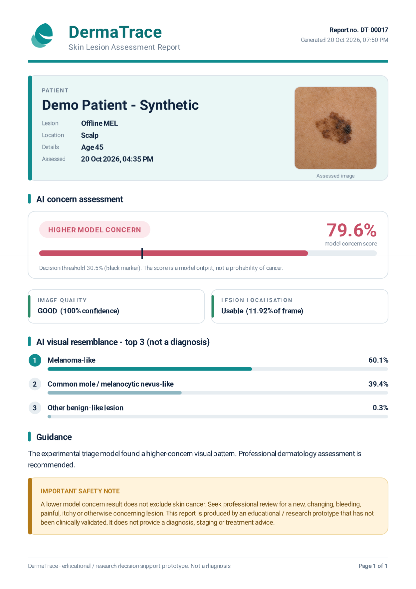<br><sub>PDF report</sub></td>
  </tr>
</table>

## Team

| Name | Roll no. |
|---|---|
| Anvay Borade | I006 |
| Mahit Naresh Daswani Chanchlani | I010 |
| Kritivya Mishra | I037 |

---

<sub>DermaTrace is a learning project. If a mole or skin spot is new, changing, bleeding or worrying you, please see a doctor.</sub>
